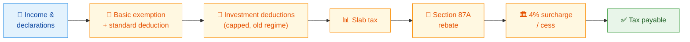
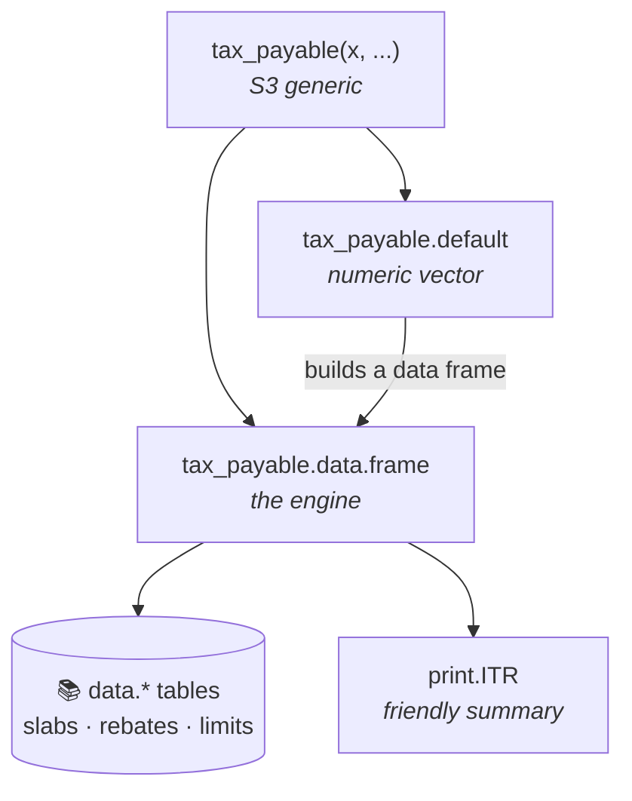
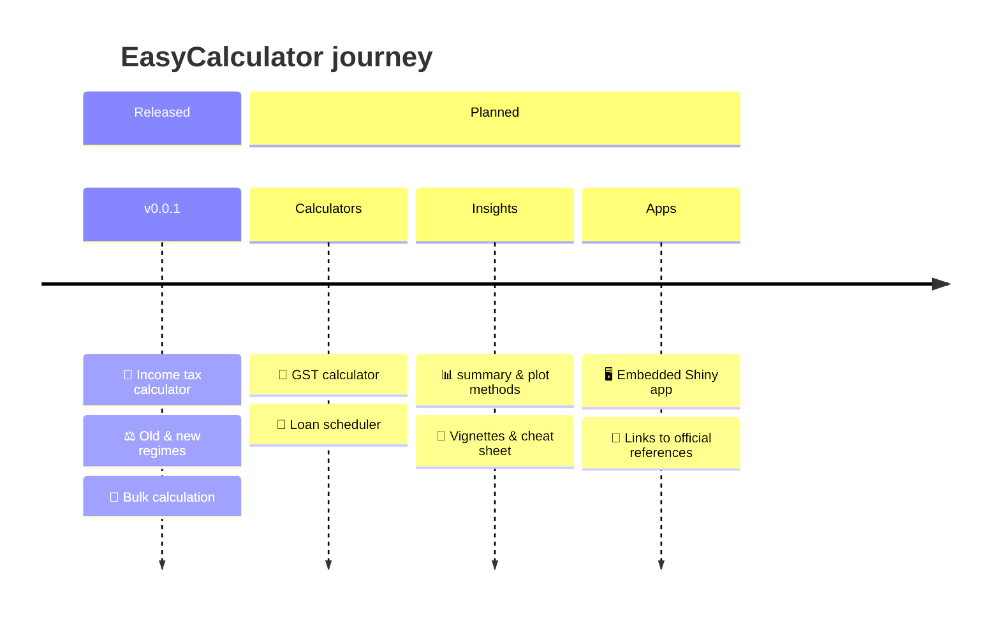

<div align="center">


# EasyCalculator

### 🇮🇳 Simple, transparent financial calculators for India — built in R

Compute income tax under the **Old** and **New** regimes for one person or a whole portfolio, in a single line of R.

<p>
  <a href="https://poduval.github.io/EasyCalculator/"></a>
  <a href="https://github.com/Poduval/EasyCalculator/actions/workflows/check-standard.yaml"></a>
  
  = 3.6.3" />
  
  
  
</p>

[📦 Install](#-installation) ·
[🚀 Quick start](#-quick-start) ·
[🧮 Tax calculator](#-tax-calculator) ·
[⚙️ How it works](#%EF%B8%8F-how-it-works) ·
[🗺️ Roadmap](#%EF%B8%8F-roadmap) ·
[🤝 Contributing](#-contributing)

</div>

---

## ✨ Why EasyCalculator?

| | Feature | What you get |
|---|---|---|
| ⚡ | **One-liner** | `tax_payable(1150000)` — done. |
| 👥 | **Bulk-ready** | Pass a data frame of hundreds of people and get one tidy result back. |
| ⚖️ | **Old vs New regime** | Switch regimes with a single argument and compare. |
| 💼 | **Deductions built in** | NPS, 80C, 80D, 24B and 80TTA, automatically capped at their statutory limits (old regime). |
| 🧾 | **Rebate & cess aware** | Standard deduction, Section 87A rebate and 4% surcharge/cess are applied for you. |
| 📊 | **Data-driven rules** | Slabs and limits live in plain data tables, not buried in code — easy to audit and update. |
| 🔍 | **Transparent output** | A step-by-step breakdown (taxable amount, slab tax, rebate, surcharge), not just a final number. |

---

## 📦 Installation

```r
# install.packages("devtools")
devtools::install_github("Poduval/EasyCalculator")
```

```r
library(EasyCalculator)
```

> 💡 Requires **R ≥ 3.6.3** and the [`plyr`](https://CRAN.R-project.org/package=plyr) package.

---

## 🚀 Quick start

### 👤 A single taxpayer

```r
# New regime (default), financial year 2024
tax_payable(1150000)

# Old regime
tax_payable(1150000, tax_regime = "old")
```

### 👥 Many taxpayers at once

```r
people <- data.frame(
  id            = c(1, 2, 3),
  annual_income = c(1400000, 2000000, 3000000)
)

tax_payable(people)
```

### 💼 With investment deductions (old regime)

```r
person <- data.frame(
  id            = 1,
  annual_income = 1500000,
  tax_regime    = "old",
  declared_NPS  = 50000,
  declared_80C  = 150000,
  declared_80D  = 25000
)

tax_payable(person)
```

---

## 🧮 Tax calculator

### 🔧 Inputs

| Column | Required | Description |
|---|:---:|---|
| `id` | ✅ | Identifier for each taxpayer |
| `annual_income` | ✅ | Gross annual income (₹) |
| `financial_year` | ➖ | Defaults to `2024` |
| `tax_regime` | ➖ | `"new"` (default) or `"old"` |
| `declared_NPS` `declared_80C` `declared_80D` `declared_24B` `declared_80TTA` | ➖ | Declared investments / deductions (old regime only) |

### 📤 Output

A data frame of class `ITR` with a readable `print()` method and full detail underneath:

| Column | Meaning |
|---|---|
| 💰 `annual_income` | Income you supplied |
| 🧾 `taxable_amount` | Income after exemptions and deductions |
| 📉 `rebate_under_investments` | Deductions allowed after applying limits |
| 🧮 `tax_from_income_slab` | Tax computed from the slabs |
| 🎁 `rebate_under_87A` | Section 87A rebate applied |
| 🏛️ `tax_surcharge` | 4% surcharge / cess |
| ✅ `tax_value` | The tax you owe |

### 📈 FY 2024 slabs

<table>
<tr>
<th>🆕 New regime</th>
<th>🕰️ Old regime</th>
</tr>
<tr>
<td>

| Income (₹) | Rate |
|---|---:|
| 0 – 3,00,000 | 0% |
| 3,00,000 – 6,00,000 | 5% |
| 6,00,000 – 9,00,000 | 10% |
| 9,00,000 – 12,00,000 | 15% |
| 12,00,000 – 15,00,000 | 20% |
| Above 15,00,000 | 30% |

</td>
<td>

| Income (₹) | Rate |
|---|---:|
| 0 – 2,50,000 | 0% |
| 2,50,000 – 5,00,000 | 5% |
| 5,00,000 – 10,00,000 | 20% |
| Above 10,00,000 | 30% |

</td>
</tr>
</table>

### 🏷️ Deduction limits (old regime, FY 2024)

| Section | Covers | Limit (₹) |
|:---:|---|---:|
| 🏦 **NPS** | National Pension Scheme | 50,000 |
| 🛡️ **80C** | Tax-saving investments | 1,50,000 |
| ⚕️ **80D** | Medical insurance | 1,50,000 |
| 🏠 **24B** | Home-loan interest | 2,00,000 |
| 💳 **80TTA** | Savings-account interest | 10,000 |

---

## ⚙️ How it works



The package is deliberately small and layered:



> 🧠 **Rules are data, not code.** Every slab, exemption and limit is stored in a table keyed by `tax_regime` and `financial_year`, so supporting a new Budget is mostly a matter of adding rows.

---

## 🗺️ Roadmap



- [x] 🧮 Income tax calculator — `tax_payable()`
- [ ] 🧾 GST calculator — `gst_calculator()`
- [ ] 🏦 Loan scheduler — `loan_schedular()`
- [ ] 📊 `summary()` and `plot()` methods
- [ ] 📘 Vignettes (examples and concepts) and a cheat sheet
- [ ] 🖥️ Embedded Shiny app
- [ ] 📅 Additional financial years

---

## ⚠️ Good to know

- 📅 Only **FY 2024** rules are included today. Unknown years fall back to 2024 in data-frame input.
- 🧑‍⚖️ This package is an aid for estimation and learning — **not** professional tax advice. Always verify against the official Income Tax Department rules or consult a qualified tax professional.

---

## 🤝 Contributing

Contributions, issues and ideas are welcome! 🙌

1. 🍴 Fork the repo and create a feature branch
2. 🛠️ Make your change (edit roxygen comments in `R/`, then run `devtools::document()`)
3. ✅ Run `devtools::check()`
4. 📬 Open a pull request

---

## 📄 License

Released under the **GPL-2** license. See [LICENSE.md](LICENSE.md).

<div align="center">

Made with ❤️ in R by [Rakesh Poduval](https://github.com/Poduval)

⭐ If you find this useful, please consider starring the repository!

</div>
